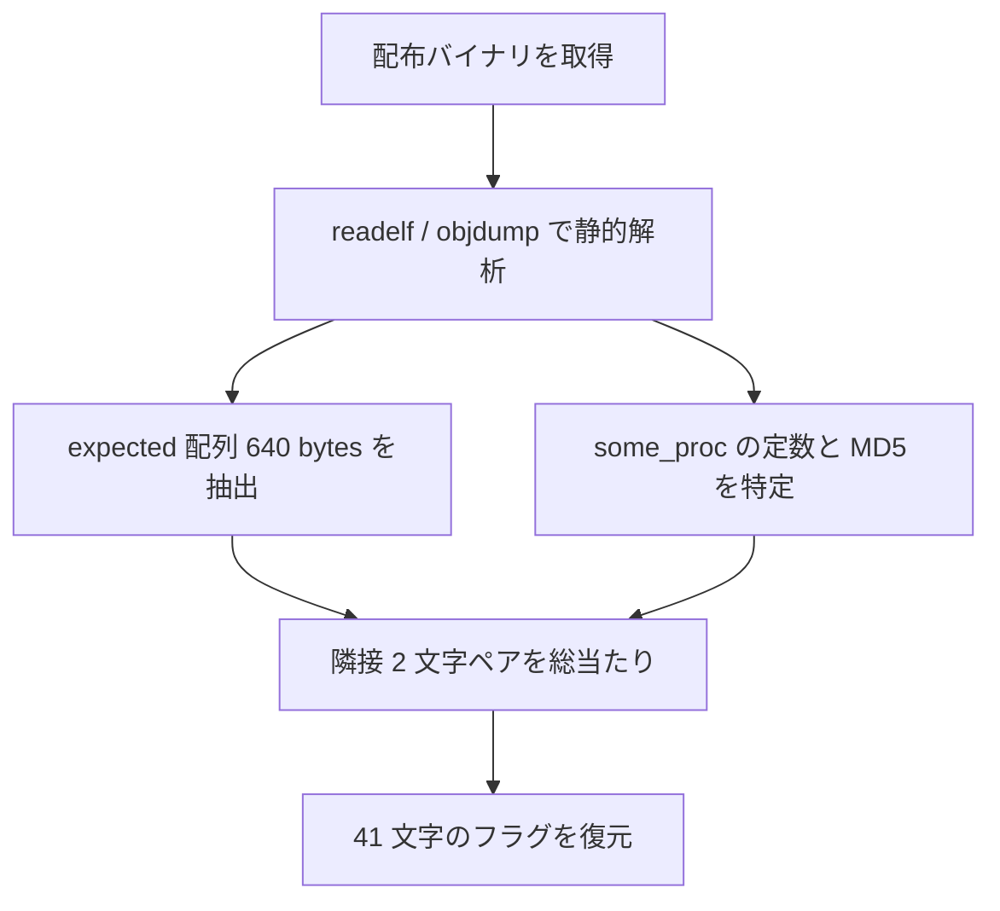

> [!IMPORTANT]
> **Solved with Gemini in Colab**
>
> この問題は Google の AI コーディングアシスタント **Gemini in Colab** を活用して解決されました。

> [!NOTE]
> この Writeup は AI により自動生成されています。 本ドキュメントは、AI アシスタントを用いて作成された Writeup です。記載内容は解法の一例であり、内容の正確性については十分にご確認の上ご利用ください。

# x32 ABI flag checker

## 概要
*   **カテゴリー**: Rev
*   **トピック**: ABI
*   **難易度**: Hard 8.0
*   **問題リンク**: [x32 ABI flag checker - Daily AlpacaHack](https://alpacahack.com/daily/challenges/x32-abi-flag-checker)

## 使用ツール
*   **Python 3**: 解法スクリプトの実装（`hashlib` / `struct` は標準ライブラリ）
*   **pyelftools**: ELF から `expected` 配列を読み出す（`pip install pyelftools`）
*   **objdump / readelf**: `main` / `is_correct` / `some_proc` の逆アセンブルとシンボル確認
*   **Gemini in Colab**: 配布ファイルの解析およびコード生成

## 問題の分析
本問題は **Daily AlpacaHack** の Rev（バイナリ解析）問題です。問題文は次のとおりです。

> This is a flag checker built to use the x32 ABI!
>
> NOTE: There is a plan to remove the x32 ABI from the Linux kernel. Consequently, it may become impossible to execute the provided file for this challenge in the future. However, since this challenge can also be solved through static analysis alone, I encourage you to give it a try.

配布されるのは **単一の実行ファイル**（アーカイブではない）です。

| 項目 | 内容 |
| :--- | :--- |
| ファイル形式 | ELF 32-bit LSB executable, x86-64（静的リンク、not stripped） |
| ELF Class | `ELFCLASS32`（ポインタ幅 32 bit） |
| Machine | `EM_X86_64`（命令セットは x86-64） |
| 意味 | いわゆる **x32 ABI**（ILP32 on x86-64）向けにビルドされている |
| 実行の可否 | カーネルに `CONFIG_X86_X32_ABI` が無いと `Exec format error` になる |

> [!TIP]
> Beginner Hint でも触れられている通り、一部の解析ツールは x32 バイナリをうまく扱えません（実行失敗・誤った ISA での逆アセンブル・読みづらいデコンパイルなど）。うまくいかないときは別ツールに切り替えるか、本 Writeup のように **静的にアセンブリを読む** 方針が安定します。

主要なシンボルは次のとおりです。

| シンボル | アドレス | 役割 |
| :--- | :---: | :--- |
| `main` | `0x401a80` | `"Input: "` を出して `%s` で読み、`is_correct` を呼ぶ |
| `is_correct` | `0x40196f` | 長さ検査と 40 ペア分のハッシュ比較 |
| `some_proc` | `0x40188d` | 2 文字 → 定数演算 → MD5 |
| `expected` | `0x4c40e0` | 正解ハッシュ 16 バイト × 40 個（計 640 バイト） |
| `MD5_Init` / `Update` / `Final` | （静的リンク） | OpenSSL 系の MD5 実装 |

接続というよりはローカルのフラグチェッカーなので、流れは次のようになります。



## 脆弱性の詳細

### x32 ABI とは何か
通常の x86-64 ユーザー空間は **LP64**（`long` / ポインタが 64 bit）です。一方 **x32** は同じ x86-64 命令セットを使いながら、ポインタを 32 bit に抑える **ILP32** モデルです。

| | 通常の x86-64 (LP64) | x32 (ILP32) |
| :--- | :--- | :--- |
| ELF Class | ELF64 | **ELF32** |
| Machine | x86-64 | **x86-64**（同じ） |
| ポインタ幅 | 64 bit | **32 bit** |
| レジスタ | 64 bit レジスタを使える | 同じく 64 bit レジスタを使える |

`readelf -h` で Class が 32-bit なのに Machine が x86-64、というのがこの問題の入口です。アセンブリ中にも `mov ebp, esp` と `movabs rcx, ...`（64 bit 即値）が混在しており、「32 bit ポインタ + 64 bit 演算」という x32 らしい見た目になります。

### main → is_correct の流れ
`main` はざっくり次の処理です。

1. `"Input: "` を表示する
2. `scanf("%s", buf)` で入力を読む（バッファ約 `0x90` バイト）
3. `is_correct(buf)` を呼ぶ
4. 戻り値が 0 なら `"Correct! The flag is %s"`、それ以外は `"Incorrect..."`

`is_correct` の要点は次の 2 点です。

1. **長さ検査**: `strlen(flag) - 1 == 0x28`、つまり **フラグ長は 41**
2. **ループ**: `i = 0 .. 39` について、隣接 2 文字 `flag[i]`, `flag[i+1]` を `some_proc` に渡し、得られた 16 バイトを `expected[i]` と `memcmp`

戻り値の意味に注意してください。`is_correct` は **一致したら 0、失敗したら 1** を返します（C の真偽とは逆です）。`main` 側の `test eax,eax / jne Incorrect` と対応しています。

### some_proc: 2 文字から MD5 へ
`is_correct` から `some_proc` へ渡る引数は、アセンブリ上おおむね次のとおりです。

| 引数 | 内容 |
| :--- | :--- |
| `edi`（下位 8 bit） | `flag[i]` |
| `esi`（下位 8 bit） | `flag[i+1]` |
| `rdx` | 乗数定数 `0x3233504c49`（ASCII では `ILP32`） |
| `rcx` | XOR 定数 `0x4942412d323378`（ASCII では `x32-ABI`） |
| `r8` | MD5 結果を書き込む 16 バイトバッファ |

関数本体は次の計算をします。

$$
\begin{aligned}
v &= (\mathrm{flag}[i] \ll 8) \mathbin{|} \mathrm{flag}[i+1] \\
\mathrm{val} &= (v \times C_{\mathrm{mul}}) \oplus C_{\mathrm{xor}} \\
h &= \mathrm{MD5}(\mathrm{pack}_{<Q}(\mathrm{val}))
\end{aligned}
$$

ここで定数は次のとおりです（数式内に `$` や日本語は入れていません）。

| 記号 | 値 | ASCII（LE） |
| :--- | :--- | :--- |
| $`C_{\mathrm{mul}}`$ | `0x3233504c49` | `ILP32` |
| $`C_{\mathrm{xor}}`$ | `0x4942412d323378` | `x32-ABI` |

`pack_<Q` は 64 bit 整数をリトルエンディアン 8 バイトにしたもので、その 8 バイトだけが `MD5_Update` に渡されます。

### 補足: なぜ総当たりで足りるか
各ステップで未知なのは高々 2 バイト（印字可能なら各 95 通り）です。しかも `i >= 1` では先頭バイトが直前ペアの末尾と一致するので、実質ほぼ 1 文字ずつの探索になります。

$$
95^{2} = 9025
\quad\text{(worst case per pair, i = 0)}
$$

40 ペアあっても現代の PC では一瞬で終わります。

### 補足: 実行できなくても解ける理由
問題文が強調している通り、x32 対応カーネルが無くても、

1. `expected` を ELF から読む
2. `some_proc` の式を Python で再現する
3. 印字可能文字を総当たりする

だけでフラグが得られます。本リポジトリの `solve.py` もこの静的ルートだけを実装しています。

## 用語解説

| 用語 | 意味 |
| :--- | :--- |
| **x32 ABI** | x86-64 CPU 上でポインタを 32 bit にする Linux の ABI。ELF は 32-bit、命令は x86-64 |
| **ILP32** | `int` / `long` / ポインタがすべて 32 bit の C データモデル。x32 のモデル名でもある |
| **LP64** | 通常の 64-bit Unix で使われるモデル（`long` とポインタが 64 bit） |
| **静的リンク** | libc などを実行ファイルに埋め込むリンク方式。本問は not stripped の静的バイナリ |
| **MD5** | 128 bit（16 バイト）のハッシュ。ここでは「ペア → 8 バイト」の指紋として使われている |
| **フラグチェッカー** | 入力が正解フラグかどうかを判定するプログラム。本問では判定ロジックそのものが解く対象 |
| **総当たり（brute force）** | 候補空間を順に試す手法。本問では印字可能 ASCII の 2 文字ペア |

## 解決スクリプト
依存は `pyelftools` のみです。配布バイナリへのパスを引数に渡して実行してください。

```bash
pip install pyelftools
python3 solve.py ./x32-abi-flag-checker
```

スクリプトの流れは次のとおりです。

1. ELF のセグメントを走査し、仮想アドレス `0x4c40e0` から 640 バイト（`expected`）を読む
2. 各 16 バイトを「正解 MD5」として 40 個のリストにする
3. `i = 0 .. 39` について、印字可能文字のペア `(c1, c2)` を試し、`some_proc` 相当の MD5 が一致するものを採用する（重なり制約あり）
4. 復元した 41 文字を表示する

本体はリポジトリ直下の [`solve.py`](./solve.py) です。
